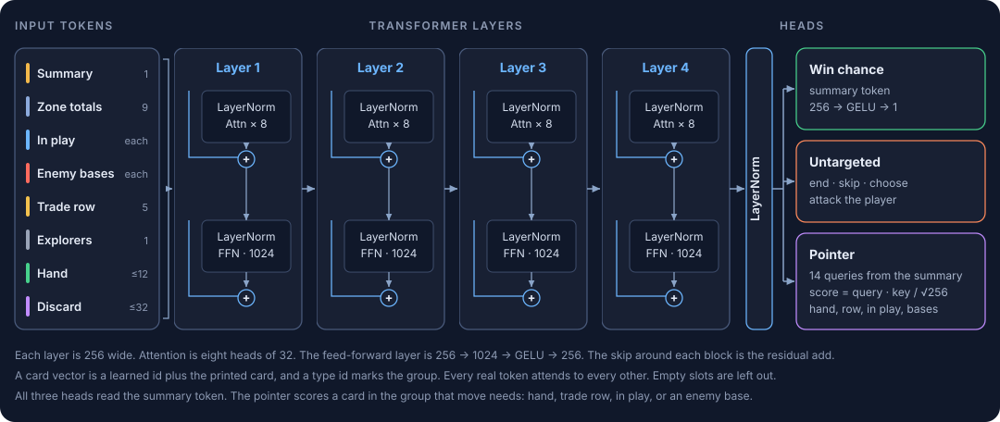

# How the bot works

I made this to finally be able to beat Chase at Star Realms

## Short answer

It's a 4.4 million parameter neural network which learned to play Star Realms by playing itself many millions of times. On a home graphics card, it can make 5k decisions per second, which translates to around 25 full games per second. It sees the same board state that a human sees - it doesn't know its own draw order, or yours. It's not cheating ...I double checked.

## Longer answer

The standard way to train a game-playing model like this is reinforcement learning, specifically, [Proximal Policy Optimization](https://karpathy.github.io/2016/05/31/rl/). We set up the model architecture such that it outputs a probability of taking any action (buy explorer, scrap viper, ...), with illegal moves masked (for example, playing a card it does not actually have). To begin with, we use a traditional dense feed-forward network, pretty much just linear algebra; each card itself is represented by a high dimension embedding which is learned over time. As it plays, we record the action it selected, along with the probability of taking that action - at the end of the game, if it won, it gets a reward of +1, and if it lost, -1. That reward is distributed among all of the actions it took, relative to its confidence (probability) in each move. That reward (or loss) is then absorbed by the network in standard gradient descent. Over time, moves that are more likely to win given the current board state become more likely.

This alone is enough to learn a reasonable policy. I played this network a few times and it played well. But we can do much, much better.

The first improvement is trivial - use a modern architecture. Replace the dense multilayer perceptrons with a stack of transformers. This immediately makes our model capable of learning more complex relationships. The input to the model becomes game state plus a representation of cards we can interact with (e.g. buy an explorer), and the model reasons about verbs (play, scrap, buy...) against cards (scout, explorer, machineBase).

The more important improvement is learning efficiency. Distributing credit for a win evenly between buying a battlecruiser and buying and explorer is very obviously inefficient, but it is not obvious how to distribute it more efficiently. We could come up with many heuristics to reweight these cleverly (based on trade, authority, attack, etc) but it would still not be obviously correct or incorrect. The more elegant approach to solve this is called Generalized Advantage Estimation - we add a head to the network which predicts the final reward (+/-1) at any given point in time, this is called the Advantage. After a game ends, instead of applying the +/-1 reward to each action equally, we scale it by the difference in advantage from right before and after taking that action. In fact, we consider the advantage of ALL game states after we took the action, so that your battlecruiser buy on turn 10 gets a reward from turn 14 when you play it (with decay). The "win meter" you see during the game is actually the advantage from the value head!

### Failed hypotheses

1. Allowing the value head access to priviledged information, for example the opponent's hand. Not cheating, because it isn't used during play, only training. Didn't help (maybe a little, but too noisy).
2. Bigger network. No impact - likely network capacity not the bottleneck.

